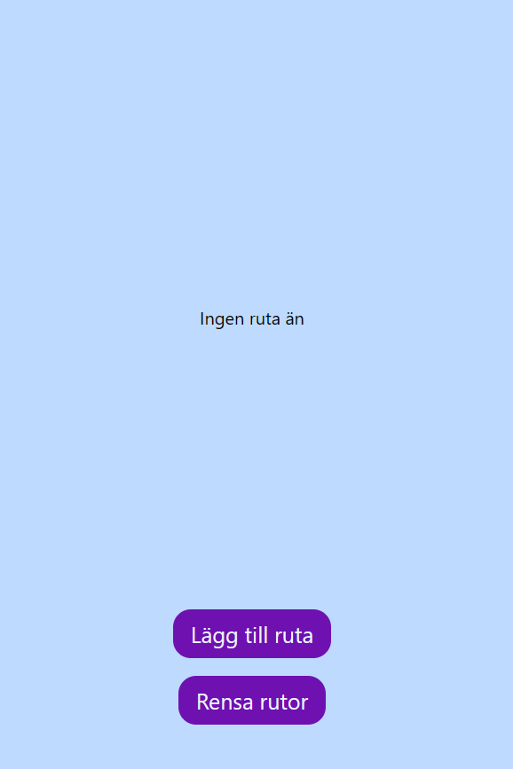

# Squares

A web application for generating different colored squares based on predefined rules.

## Screenshots

### Start view



### Functionality


## About the project

SquareApi is a small application where users can generate colorful squares according to specific rules. The project was created as an assignment for a possible internship but later used as a learning possibility about C#/.NET.

## Features

- Generate colorful squares
  - Each square with a different color
- Display generated results in a visual grid
  - The visual placement is a predefined pattern

## What I learned

- Exploring C#/.NET for the first time
- Working with JSON
- Connecting frontend functionality with application logic

## Technologies

- React
- JavaScript
- C#/.NET
- Tailwind
- JSON
- Vite

## Assigment

Create a website that generates a new square with a new color each time you press the button. The squares will place themself in a squarepattern.

- ### Frontend
  #### React.js
  The application is able to render squares dynamically on the page
- ### Backend
  #### .NET/C#
  Managing state (store and get data from a _JSON-file_)

## Getting Started

### Installation

```bash
git clone PROJECT-URL
```

### Start the Developmentserver

```bash
npm run dev
```

The application is now running on http://localhost:5173/ (via Vite)

## Folder Structure

The project uses **React + Vite** with **Tailwind CSS**

```plaintext
squares/
| - docs/            # Documentation Files
| - src/
|  | - components/      # Reusable Components
|  | - screens/         # Page-components
|  | - util/            # Functional js-files
| - package.json     # The project's dependencies
| - README.md        # The project's documentation
| - vite.config.js   # Configuration for Vite
```

## User Instructions

1. **Add Square**
   - Press button with the text:
     "Lägg till ny ruta"

2. **See a on the page**
   - A new square in a new color appear
   - The more squares you generate the more you see the squarepattern they form together
3. **Clear all squares**
   - Press button with the text:

     "Rensa rutor"

4. **See on the page**
   - The squares disappear

## React + Vite

This template provides a minimal setup to get React working in Vite with HMR and some ESLint rules.

Currently, two official plugins are available:

- [@vitejs/plugin-react](https://github.com/vitejs/vite-plugin-react/blob/main/packages/plugin-react) uses [Babel](https://babeljs.io/) for Fast Refresh
- [@vitejs/plugin-react-swc](https://github.com/vitejs/vite-plugin-react/blob/main/packages/plugin-react-swc) uses [SWC](https://swc.rs/) for Fast Refresh

## Expanding the ESLint configuration

If you are developing a production application, we recommend using TypeScript with type-aware lint rules enabled. Check out the [TS template](https://github.com/vitejs/vite/tree/main/packages/create-vite/template-react-ts) for information on how to integrate TypeScript and [`typescript-eslint`](https://typescript-eslint.io) in your project.
